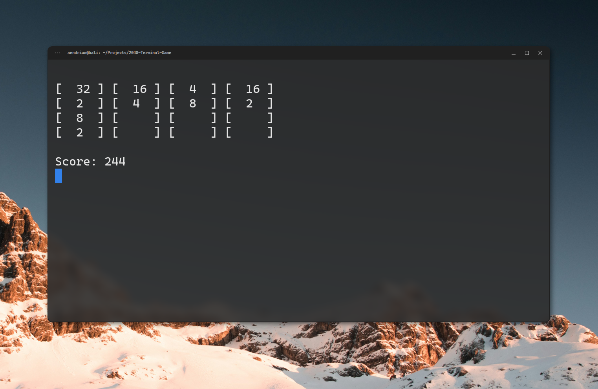

# 2048 Terminal Game

An educational recreation of the classic 2048 game which can be played inside the terminal.

## Build

bash:
```bash
make
```

## Run

bash (in the same directory):
```bash
./2048-terminal-game
```

or from anywhere in the file system, if you add the executable to a path directory using `make install`:
```bash
play2048
```

### Options

- `play2048` - Starts a new game.
- `play2048 -r` or `play2048 --resume` - Resumes the saved game. If there is no saved game, it starts a new one.
- `play2048 -h` or `play2048 --help` - Shows the available options.

## Saving and resuming

The game is saved automatically after every move to `~/.local/share/play2048/save` (or `$XDG_DATA_HOME/play2048/save` if that variable is set). Press `q` to save and quit, then continue later with `play2048 -r`. The save is deleted when the game is won or lost. Starting a new game with `play2048` overwrites the saved one after the first move.

## Adding the executable to the Path
- `make install` - Compiles the game (if not already done) and automatically moves a copy to your `~/.local/bin folder` as `play2048`.
- `make uninstall` - Removes the command from your system.
- `make clean` - Removes the local `.c` executable from your current project folder.

## How to play

1. Use the `arrow keys` to slide the tiles in the desired direction.
2. When 2 tiles of the same value collide (one slides into the other) there remains a single tile with the value of the sum of those 2. 
3. Use the `r` key to undo one move, and the `q` key to save and quit.
4. A new tile of `2` or `4` spawns in a free space after every valid move.
5. The game is won when the number `2048` is created.
6. The game is lost when there are no possible moves left.

## Screenshot of the game


